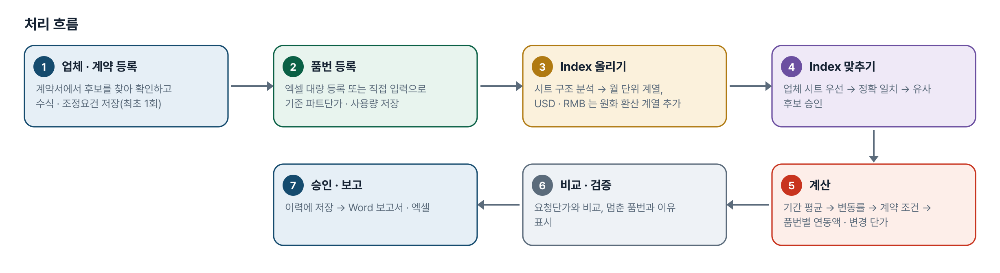
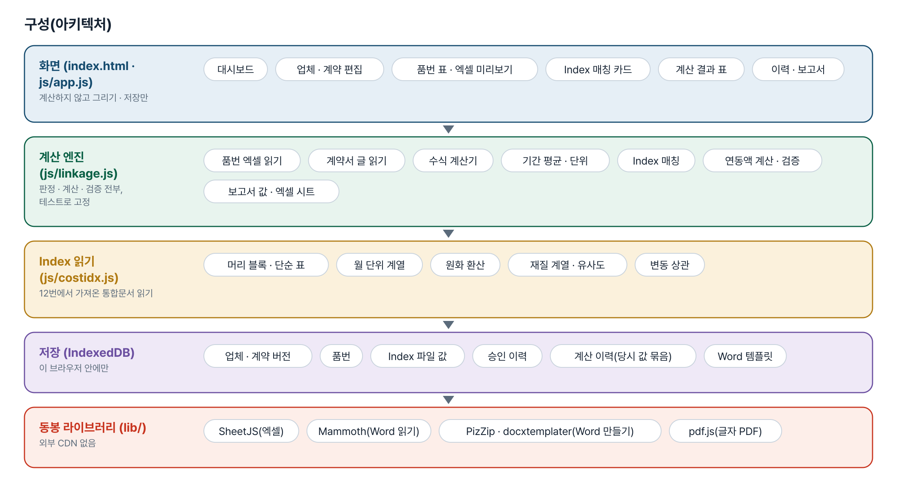
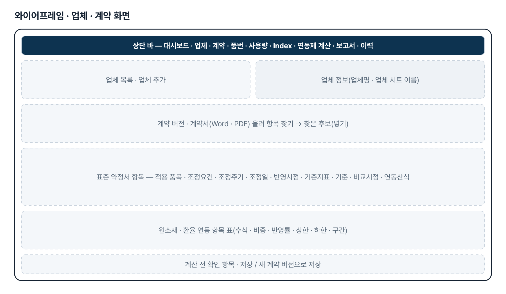
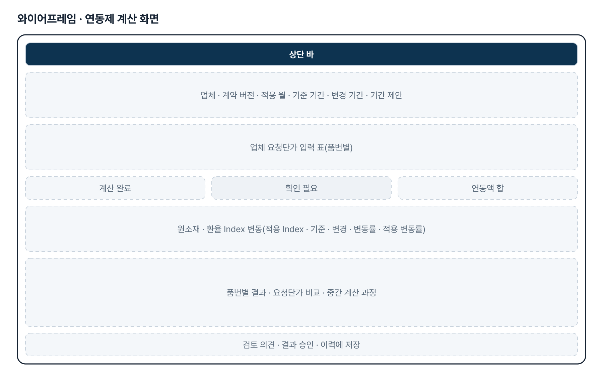
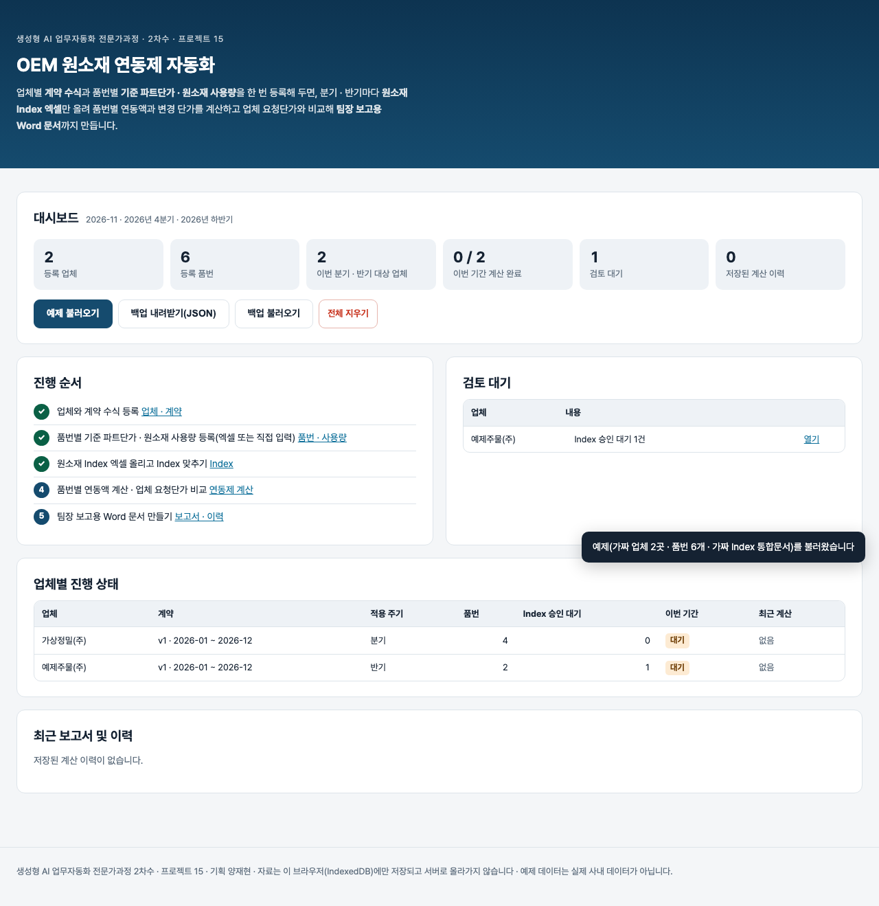

# OEM 원소재 연동제 자동화 — 프로젝트 기획서 v1.0

- 기획: 양재현 · 작성일 2026-11-12 · 생성형 AI 업무자동화 전문가과정 · 2차수 프로젝트 15
- 바로 쓰기: https://build-2611-15.jobability.co.kr/
- 워드 판: `docs/기획서/build-2611-15_양재현_OEM원소재연동제자동화_기획서_v1.0.docx`

## 개요

협력업체별 계약 수식 · 조정요건과 품번별 기준 파트단가 · 원소재 사용량을 나눠 등록해 두고, 분기 · 반기마다 원소재 Index 엑셀을 올리면 품번별 연동액과 변경 단가를 계산해 업체 요청단가와 비교하고 팀장 보고용 Word 문서를 만드는 브라우저 도구입니다. 자료는 이 브라우저에만 저장되고 서버로 올라가지 않습니다.

### 배경 · 현재 업무
- 협력업체와 맺은 원소재 연동제(납품대금 연동 특별약정)는 업체마다 수식 · 조정요건 · 주기가 다르고, 한 업체 안에서도 품번마다 기준 파트단가와 원소재 사용량이 다릅니다.
- 분기 · 반기마다 구매기획팀이 배포한 원소재 Index 엑셀에서 값을 찾아 품번별로 손으로 계산하고, 업체 요청단가와 비교해 팀장 보고 문서를 다시 만드는 일이 반복됩니다.
- 도면을 쓸 수 없게 되어 12번(도면 기반 단가 영향 분석)에서 과제를 바꿨습니다. 도면 대신 계약 정보와 품번별 사용량 표를 한 번 등록해 두는 방식입니다.

### 목표
- 업체별 계약 정보(표준 약정서 1~9번 항목 · 수식 · 조정요건)와 품번별 실제 데이터를 분리해 관리합니다.
- 품번별 원소재 정보를 엑셀 대량 등록 또는 화면 직접 입력으로 넣고, 원소재 종류가 늘어도 구조를 바꾸지 않습니다.
- Index 엑셀만 올리면 계약 원소재와 Index 를 맞추고(업체 시트 우선 · 정확 일치 · 유사 후보 승인) 품번별 연동액과 변경 단가를 계산합니다.
- 업체 요청단가와 비교하고 팀장 보고용 Word 문서와 엑셀을 만들며, 모든 계산 · 승인 이력을 당시 값 그대로 보존합니다.

## 요구사항과 구현

| 기획서 요구 | 구현 |
|---|---|
| 업체별 계약정보와 품번별 정보 분리 | 업체 1 — 계약 버전 N — 연동 항목 N, 업체 1 — 품번 N — 원소재 사용량 N. 원소재는 고정 열이 아니라 이름 → 값 구조 |
| 품번별 원소재 엑셀 대량 등록 | 머리글 이름으로 열 인식(순서 무관) · 원소재 열 동적 인식 · 열 직접 지정 · 미리보기 · 신규/기존/오류 구분 · 행 · 열을 짚은 오류 · 덮어쓰기 동의 · 승인 후 저장 · 양식 내려받기 · 파일명 · 일자 기록 |
| 품번 수기 입력 | 표에서 행(품번) · 열(원소재) 추가 · 삭제 · 이름 바꾸기, 저장 전 확인, 엑셀과 같은 구조로 저장 |
| 환율 예외 처리 | 환율은 사용량 칸 없음(「-」), kg 입력 불가, 적용 비중 100% 고정, 일반 원소재 kg 과 합산하지 않고 별도 연동액으로 계산 |
| 계약서 등록 · 분석 | Word · 글자 PDF 를 읽어 표준 「납품대금 연동 특별약정서(별첨)」 1~9번 항목과 기간 · 원재료 후보를 찾음. 자동으로 넣지 않고 담당자가 「넣기」. 고치면 새 계약 버전 |
| 계약 수식 관리 | 중량 연동식 · 비중 연동식 · 사용자 정의 수식(사칙연산) · 환율 별도 연동, 조정요건(±%) · 항목별 최소 변동률 · 상한 · 하한 · 구간별 차등 · 반영률. 수식 미정이면 계산 중단 |
| 원소재 Index 엑셀 관리 | 시트 전부 분석 — 가로형(원소재가 행 · 날짜가 열, 기획자 시제품 형식) · 머리 블록(품목이 열) · 세로형(날짜 열 + Index 열). 기간 · 빈 달 표시, 업체명과 같은 시트(또는 「원본 시트」 칸) 우선, 소재가 맞지 않으면 자동 적용하지 않음. Index 파일 지우기(승인 연결만 해제) |
| 정확 Index 매칭 · 유사 Index 추천 | 이름 · 규격 재질이 맞는 Index 하나면 적용, 여럿이면 담당자 선택. 없으면 유사 후보 최대 3개(재질 유사도 · 변동 상관 · 방향 일치 · 기간 변동률 · 데이터 완전성 · 점수) — 계약상 대체 허용 + 승인 전에는 계산에 쓰지 않음 |
| 원소재 연동제 계산 | 기준 · 변경 기간 평균 → 변동률 → 계약 조건 적용 → 품번별 사용량 · 비중으로 연동액, 환율은 별도. 중간 계산 과정 표시 |
| 업체 요청단가 비교 | 품번별 요청단가 입력 → 계약 계산 변경단가와 차액 · 요청 인상률 · 계약 계산 인상률, 원소재로 설명되는 금액과 구분 |
| 계산 결과 검증 | 수식 불명확 · 품번 중복 · 사용량 · 단가 누락 · Index 누락 · 기간 · 계약 버전 불일치 · 단위 불일치 · 유사 Index 미승인 · 대체 불허 · 비정상 중량 · 환율 kg · 환율 100% 불일치 · 원소재 중복 — 보정하지 않고 멈추거나 알림 |
| Word 보고서 자동 생성 | Word 양식(.docx)에 꼬리표를 적어 올리면 서식을 유지한 채 값만 채움(docxtemplater). 기본 틀 제공, 없는 값은 「확인 필요」 |
| 데이터 저장 · 이력 관리 | IndexedDB 에 업체 · 계약 버전 · 품번 · Index 파일 · 승인 이력 · 계산 이력 저장. 이력은 당시 계약 · 품번 · 결과를 통째로 묶어 두어 나중에 바뀌지 않음. JSON 백업 |
| 로컬 · 오프라인 · 외부 전송 금지 | 정적 페이지, 라이브러리(SheetJS · Mammoth · PizZip · docxtemplater · pdf.js) 리포에 동봉, 외부 CDN · 서버 · AI 호출 없음 |

## 주요 기능

- **대시보드** — 업체 · 품번 수, 이번 분기 · 반기 대상과 계산 완료 수, 검토 대기(계약 미비 · Index 승인 대기 · 확인 필요 품번), 최근 이력을 한 화면에 보여 줍니다.
- **업체 및 계약 관리** — 표준 약정서 항목(적용 품목 · 조정요건 · 조정주기 · 조정일 · 반영시점 · 기준지표 · 기준 · 비교시점 · 연동산식)과 원소재 · 환율 연동 항목의 수식 · 조건을 계약 버전으로 관리합니다.
- **품번 및 원소재 사용량 관리** — 품번마다 기준 파트단가 · 현재 구매단가 · 원소재별 사용량(kg) · 환율 적용 여부를 엑셀 대량 등록이나 화면 표로 관리합니다.
- **Index 데이터 관리** — Index 엑셀의 시트 구조를 분석하고 계약 원소재와 Index 를 맞춥니다. 유사 Index 는 근거와 점수를 보고 승인합니다.
- **연동제 계산** — 적용 월과 기준 · 변경 기간을 정해 품번별 연동액 · 변경 단가를 계산하고 업체 요청단가와 비교합니다.
- **보고서 및 이력 관리** — 저장한 결과로 Word 보고서와 엑셀을 만들고, 과거 결과를 다시 보거나 이력끼리 비교합니다.

## 처리 흐름(파이프라인)

1. **업체 · 계약 등록** — 계약서에서 후보를 찾아 확인하고 수식 · 조정요건 저장(최초 1회)
2. **품번 등록** — 엑셀 대량 등록 또는 직접 입력으로 기준 파트단가 · 사용량 저장
3. **Index 올리기** — 시트 구조 분석 → 월 단위 계열, USD · RMB 는 원화 환산 계열 추가
4. **Index 맞추기** — 업체 시트 우선 → 정확 일치 → 유사 후보 승인
5. **계산** — 기간 평균 → 변동률 → 계약 조건 → 품번별 연동액 · 변경 단가
6. **비교 · 검증** — 요청단가와 비교, 멈춘 품번과 이유 표시
7. **승인 · 보고** — 이력에 저장 → Word 보고서 · 엑셀

## 구성(아키텍처)

- **화면 (index.html · js/app.js)** — 대시보드 · 업체 · 계약 편집 · 품번 표 · 엑셀 미리보기 · Index 매칭 카드 · 계산 결과 표 · 이력 · 보고서
- **계산 엔진 (js/linkage.js)** — 품번 엑셀 읽기 · 계약서 글 읽기 · 수식 계산기 · 기간 평균 · 단위 · Index 매칭 · 연동액 계산 · 검증 · 보고서 값 · 엑셀 시트
- **Index 읽기 (js/costidx.js)** — 머리 블록 · 단순 표 · 월 단위 계열 · 원화 환산 · 재질 계열 · 유사도 · 변동 상관
- **저장 (IndexedDB)** — 업체 · 계약 버전 · 품번 · Index 파일 값 · 승인 이력 · 계산 이력(당시 값 묶음) · Word 템플릿
- **동봉 라이브러리 (lib/)** — SheetJS(엑셀) · Mammoth(Word 읽기) · PizZip · docxtemplater(Word 만들기) · pdf.js(글자 PDF)

## 화면 구성(와이어프레임)

## 규칙 · 판정 기준

- 업체별 계약 수식과 품번별 실제 데이터를 분리합니다. 한 업체의 모든 품번에 같은 사용량 · 같은 기준 파트단가를 적용하지 않습니다.
- 계약서에 적힌 수식이 가장 우선입니다. 수식이 「미정」이면 그 계약은 계산하지 않고 확인을 요청합니다. 계약서 문구를 자동으로 수식으로 해석하지 않습니다.
- 올린 Index 엑셀의 값만 씁니다. 인터넷 가격이나 만들어 낸 Index 를 쓰지 않습니다.
- 기간 값은 그 기간에 값이 있는 달의 평균입니다. 값이 없는 달은 알리고, 기간 전체에 값이 없으면 다른 달 값을 끌어오지 않고 멈춥니다.
- 적용 변동률 = 조정요건(항목별 최소 변동률이 있으면 그 값) 미만이면 0 → 상한 · 하한 → 구간별 반영률(없으면 반영률) 순서입니다.
- 중량 연동식: 연동액 = 사용량(kg) × 기준 Index(원/kg) × 적용 변동률. Index 단위가 원/kg · 원/ton 이 아니면 계산하지 않습니다. 비중 연동식: 기준 파트단가 × 비중 × 적용 변동률.
- 환율: 사용량 없음, 적용 비중 100% 고정. 연동액 = (기준 파트단가 전체 또는 품번별 환율 대상 금액) × 환율 변동률. 무엇에 곱할지 계약에서 정하지 않으면 계산하지 않습니다.
- 빈 칸은 미입력, 0 은 쓰지 않음입니다. 중량 연동식에서 사용량이 빈 칸이면 그 품번은 계산하지 않습니다.
- 유사 Index 는 계약이 대체를 허용하고 담당자가 승인했을 때만 씁니다. 결과와 보고서에 「유사 Index」로 표시합니다.
- 저장한 이력은 당시 계약 · 품번 · Index 값 · 결과의 사본입니다. 계산에 쓰인 계약 버전은 고치지 못하고 새 버전으로만 저장합니다.

## 검증

- 계산 규칙 테스트 122개 · 화면 연기 테스트 52개 통과
- 계산 규칙 122개 — 숫자 읽기(빈 칸과 0), 품번 엑셀, 수식 계산기, 기간 평균 · 단위, 계약 조건, Index 맞추기, 중량 · 비중 · 사용자 정의 · 환율 계산, 멈추는 조건, 요청단가 비교, 계약서 글 읽기, 보고서 값, 가로형 Index.
- 일부러 깨뜨려 확인 — 중량 연동식의 나눗셈을 바꾸면 13개, 조정요건 판정을 끄면 4개가 실패합니다.
- 화면 52개 — 예제 → 계약서 올리기(표준 약정서) → 품번 직접 입력 → 엑셀 대량 등록 → Index 승인 → 계산 → 이력 저장 → Word · 엑셀 내려받기(내용 확인) → 가로형 Index 올리기 · Index 지우기 → 새 계약 버전 → 새로고침 뒤 유지 → 390px 넘침 없음.

## 이번 판에서 하지 않는 것

- 스캔 PDF(그림) 계약서의 글자 읽기(OCR)는 넣지 않았습니다. 인터넷에서 OCR 엔진을 내려받아야 해 「외부 CDN 없이 로컬에서」 원칙과 맞지 않습니다. 글자 PDF · Word 를 올리거나 직접 입력합니다.
- 계약서 문구를 수식으로 자동 변환하지 않습니다. 수식 종류와 조건은 담당자가 고릅니다.
- 자료는 이 브라우저(IndexedDB)에만 있습니다. 다른 PC · 브라우저로 옮기려면 백업(JSON)을 내려받아 불러옵니다. 계약서 원본 파일은 파일 이름만 기록하고 보관하지 않습니다.
- 기준시점을 「직전 조정 시점」으로 자동 추적하지 않습니다. 기준 기간은 담당자가 정하고, 도구는 적용 월 · 주기로 제안만 합니다.
- Word 템플릿은 docx 만 됩니다. 꼬리표가 한 칸 안에서 서식이 갈리면 인식되지 않을 수 있어 꼬리표는 한 번에 입력해야 합니다.

## 다음 단계

- 실제 약정서(값을 가린 사본) 1건으로 항목 읽기 결과 확인 · 연동산식 유형 보강
- 직전 조정 이력에서 기준시점 자동 제안(조정요건 미달 시 기준시점 유지)
- 실제 팀장 보고 양식에 꼬리표를 넣은 템플릿 맞춤
- 스캔 계약서용 OCR 엔진 동봉 여부 검토

## 버전 이력

- **v1.0** (2026-11-12) — 과제 변경 — 12번(도면 기반)에서 「OEM 원소재 연동제 자동화」로, 프로젝트 15 신설 / 업체 · 계약 버전 · 품번 · Index · 계산 · 보고서 6개 메뉴와 대시보드 / 계산 엔진 linkage.js(중량 · 비중 · 사용자 정의 · 환율, 조정요건 · 상한 · 하한 · 구간), Index 읽기는 12번 costidx.js 재사용 / 기획자 시제품 V2 의 표준 약정서 1~9번 항목 구조 · 가로형 Index Excel 형식 · Index 삭제를 반영 / Word 보고서(템플릿 꼬리표) · 엑셀 4시트, IndexedDB 저장 · 백업, 계산 테스트 122 · 화면 테스트 52
